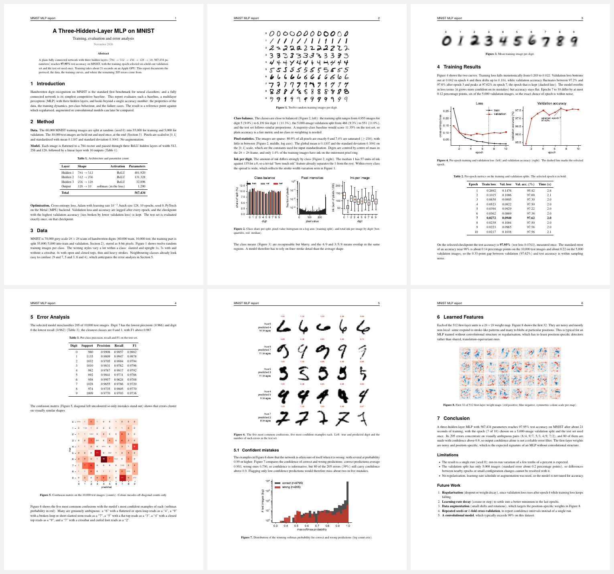

# MNIST MLP

A three-hidden-layer MLP on MNIST, trained properly (train / validation / test) and written up as a 6-page report that doubles as a template for papers and talks.

**97.95 % test accuracy** in about 21 s of training on an Apple GPU. The epoch is chosen on a 5,000-image validation split; the test set is evaluated exactly once.

## What you get

- **A reproducible baseline**: 784 → 512 → 256 → 128 → 10, ReLU, Adam, 567,434 parameters, one file (`train.py`).
- **A finished report** ([`report/report.pdf`](./report/report.pdf)): introduction, data exploration, training curves, per-class metrics, confusion matrix with real examples of the top confusions, confidence analysis, learned first-layer filters, limitations and future work.
- **Reusable figures**: every plot in `report/` is a standalone vector PDF, ready to drop into slides or a manuscript.

## Quick start

```bash
uv venv .venv && source .venv/bin/activate
uv pip install -r requirements.txt
python train.py        # trains, selects the epoch on validation, tests once -> history.json, predictions.npz
python eda.py          # data exploration figures
python visualize.py    # result figures + report/metrics.json
cd report && tectonic -X compile report.tex   # or: xelatex report.tex (twice)
```

The report needs the TeX Gyre fonts (Termes, Heros, Cursor).

## Protocol

| Split | Size | Used for |
|---|---|---|
| train | 55,000 | gradient updates |
| validation | 5,000 | per-epoch monitoring and picking the epoch |
| test | 10,000 | one final evaluation of the picked checkpoint |

Seed 0, 10 epochs, batch 128, learning rate 1e-3. Single run: expect a few tenths of a percent of run-to-run variation.

## Layout

```
train.py        model, split, training, epoch selection, single test evaluation
eda.py          data exploration figures (samples, class balance, pixel stats, ink, class means)
visualize.py    result figures and metrics.json
report/         report.tex, report.pdf and all figures (PDF)
history.json    per-epoch metrics and final numbers
split.npz       the exact train/validation indices
mnist_mlp.pt    trained weights (selected epoch)
```

`data/` (the MNIST download) and `predictions.npz` are regenerated by the scripts and are not tracked.
